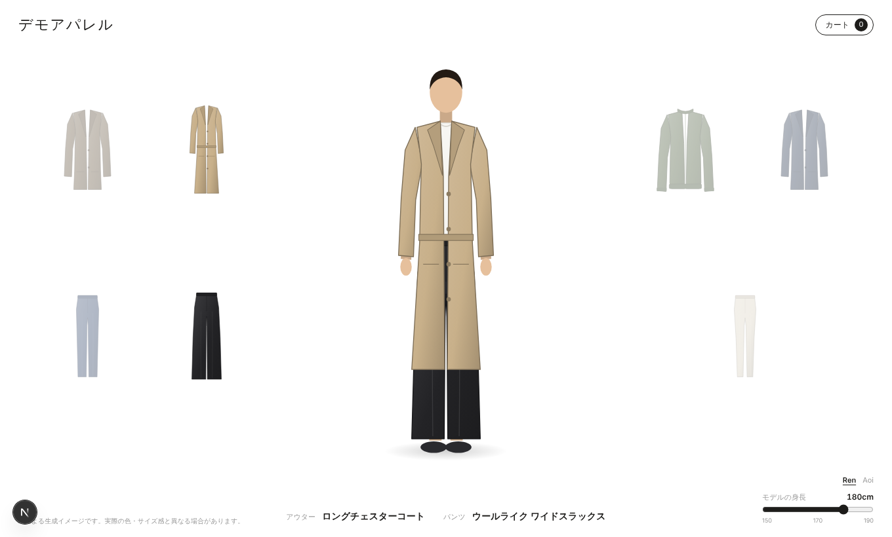
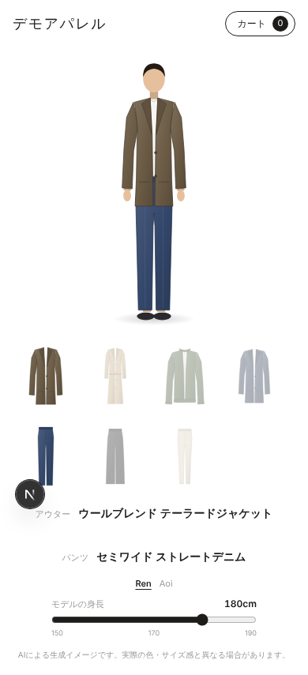
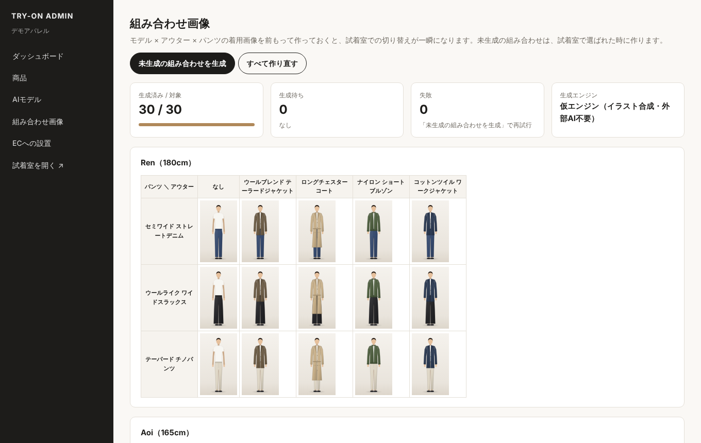
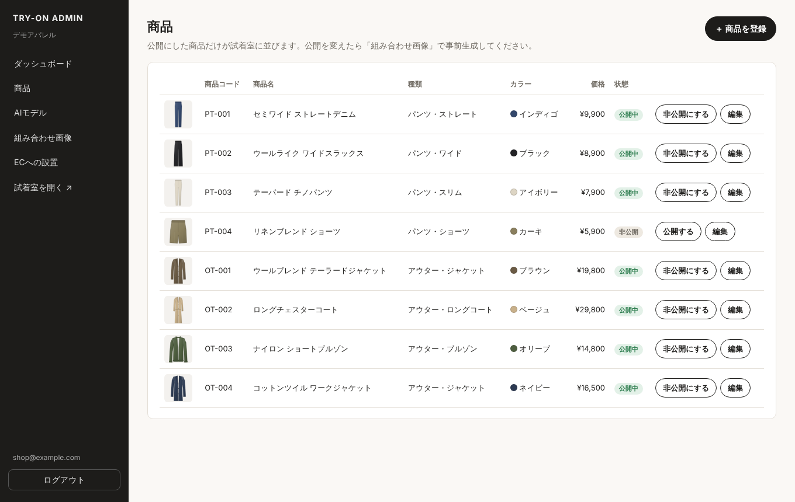

# 試着シミュレータ（MVP）

アパレル事業者向けの「AIモデルの試着室」です。中央に立つAIモデルに、アウターとパンツを選んで着せ替えられます。
組み合わせごとの着用画像は前もって作っておく（事前生成）ので、切り替えは一瞬です。

仕様書: 構想書・仕様書（初版）の 2.4「参考事例から取り入れる点」F-FIT-01〜04 を中心に実装しています。

| 試着室（PC） | 試着室（スマホ） |
| --- | --- |
|  |  |

| 管理画面：組み合わせ画像 | 管理画面：商品 |
| --- | --- |
|  |  |

## できること

**試着室（お客さま向け）** `/t/demo`
- 白い背景の中央に大きくAIモデル。左右に商品画像だけを並べ、上段がアウター、下段がパンツ（名前や価格は出さない）
- 押すとすぐ着せ替わる。選んでいない商品は薄く表示。選んでいるアウターをもう一度押すと脱ぐ
- 画面下に選択中の商品名だけを表示。名前を押すと、価格・サイズ・カートに入れるボタンが出る（素材などは「商品情報を見る」で開く）
- 右上にカート、右下に小さな身長スライダー（150〜190cm）とモデルの切り替え
- まだ作っていない組み合わせは、その場で生成して表示（オンデマンド生成）
- スマホではモデルの下に、アウターとパンツを1列ずつ横スクロールで並べる
- ECサイトにはリンクまたは iframe 埋め込みで設置。「カートに入れる」は埋め込み先ページに通知（postMessage）

**管理画面（事業者向け）** `/admin`
- ログイン
- ダッシュボード（試着室の表示数、カート投入数、今月の生成枚数と上限、商品別の反応）
- 商品の登録・編集・削除、公開／非公開の切り替え、商品画像のアップロード
- AIモデルの登録・編集
- 組み合わせ画像の一括事前生成と状況表（モデル × アウター × パンツ）
- ECへの設置方法（URL、商品を指定して開くリンク、iframe タグ、カート通知の受け取り方）
- 運営者メニュー（事業者の追加・停止、月間生成上限、生成エンジンの割り当て）

## 手元で動かす手順

1. **Node.js 22（LTS）以上を入れる**（<https://nodejs.org/ja> から「LTS」をダウンロード）。
   入ったかどうかは、ターミナル（Macは「ターミナル」、Windowsは「PowerShell」）で `node -v` と打つと `v22.○○` のように表示されます。
2. **このリポジトリを手元に持ってくる**。GitHubの緑色の「Code」ボタン →「Download ZIP」で落として展開するのが一番かんたんです。
3. ターミナルで展開したフォルダに移動して、次の2つを順に実行します。
   ```
   npm install
   npm run dev
   ```
4. ブラウザで <http://localhost:3000> を開きます。
   - 試着室: <http://localhost:3000/t/demo>
   - 管理画面: <http://localhost:3000/admin>
     - 事業者としてログイン: `shop@example.com` / `demo1234`
     - 運営者としてログイン: `operator@example.com` / `demo1234`

初回起動時にデモ用の事業者・モデル2人・商品8点が自動で入り、組み合わせ画像も自動で作られます。
データは `data` フォルダに保存されます。最初からやり直したいときは、サーバーを止めて `data` フォルダを消してください。

## 生成エンジンについて（大事）

いま入っているのは **仮エンジン（イラスト合成）** です。外部のAIを使わずに、服の形と色をイラストのモデルに重ねて描きます。
画面の動きや、事前生成・公開・集計といった運用の流れを確かめるためのもので、写真品質の画像ではありません。

写真品質にするには、画像生成AIのエンジンに差し替えます。差し替え口は `src/lib/engines/index.ts` にあり、
OpenAI の画像編集API を使う `openai` エンジンの下書きも入れてあります（APIキーが無い環境で作ったため**未検証**）。

使うときは、`.env.example` を `.env.local` という名前でコピーして次を設定し、サーバーを起動し直します。

```
TRYON_ENGINE=openai
OPENAI_API_KEY=（発行したキー）
```

あわせて、管理画面で **モデルの全身画像** と **商品の平置き写真** を PNG/JPEG で登録してください（仮エンジン用のイラストは使えません）。
運営者メニューから、事業者ごとにエンジンを切り替えることもできます。

## 仕様書との対応と、今回やっていないこと

| 仕様 | 状態 |
| --- | --- |
| F-FIT-01 試着室ビュー | 実装 |
| F-FIT-02 組み合わせの事前生成（未生成分のみオンデマンド） | 実装 |
| F-FIT-03 商品詳細パネル | 実装 |
| F-FIT-04 モデルの着用注記 | 実装 |
| F-AUTH-01 管理画面ログイン | 実装（メール＋パスワード。パスワード再設定は未実装） |
| F-TEN-01 テナント管理・月間上限 | 実装 |
| F-PRD-01 / F-PRD-04 商品登録・公開切替 | 実装（色違いは別商品として登録） |
| F-JOB-02 生成エンジンの差し替え | 実装 |
| F-ANA-01 利用状況 | 実装（30日間の集計） |
| F-FIT-05 サイズによるシルエット変化 | 未実装（Could） |
| F-FIT-06 ブランド専用AIモデルの生成 | 一部（モデル画像の登録まで。生成は未実装） |
| CSV一括登録、メンバー招待、パスワード再設定 | 未実装 |
| 本人写真での試着 | フェーズ2のため対象外 |

## 技術メモ（開発者向け）

- Next.js 15（App Router）+ TypeScript。追加のネイティブモジュールなし
- データベースは Node.js 標準の SQLite（`node:sqlite`）。本番で PostgreSQL に移す場合は `src/lib/db.ts` と `src/lib/repo.ts` を差し替える
- 画像はローカルの `data/storage`。S3 / R2 に移す場合は `src/lib/storage.ts` を差し替える
- 生成キューはWebサーバーと同じプロセスで動く簡易版（同時2件、失敗時は最大3回まで再試行）
- すべての問い合わせで `tenant_id` を条件に入れ、事業者同士のデータが混ざらないようにしている
- 公開API: `GET /api/v1/t/{slug}/catalog`、`POST /api/v1/t/{slug}/looks`、`GET /api/v1/t/{slug}/looks/{id}`、`POST /api/v1/t/{slug}/events`

```
npm test           # 自動テスト
npm run typecheck  # 型チェック
npm run build      # 本番用ビルド
npm start          # 本番モードで起動（ビルド後）
```
